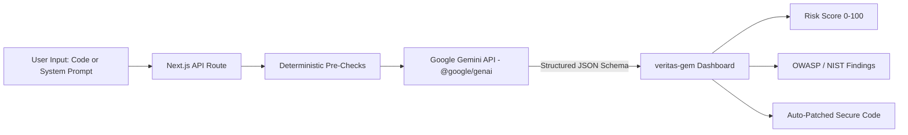

# veritas-gem // AI Security & Governance Auditor

> **Autonomous code security inspection, prompt injection defense, and algorithmic transparency auditing powered by Google Gemini API.**


## 01. Overview

**veritas-gem** is an interactive DevSecOps and AI Governance tool designed for students, researchers, and developers. Instead of acting as a generic chatbot, it uses **Google Gemini Structured Outputs** and **System Instructions** to inspect source code snippets and AI system prompts in real time.

With a single click, `veritas-gem` performs a 3-stage audit:
1. **Security & Trust Score (0–100):** Evaluates overall exposure to vulnerabilities and ethical risks.
2. **Threat & Governance Mapping:** Detects hardcoded secrets, injection vectors (SQLi, XSS, Prompt Injection), and algorithmic opacity, mapping findings to **OWASP Top 10** and **NIST AI RMF**.
3. **Automated Remediation:** Generates a secure, refactored code or prompt patch side-by-side with an educational explanation of the vulnerability.

---

## 02. System Architecture



---

## 03. Tech Stack & Open Source Disclosure

Built from scratch during **GenHacks 2026** (November – December 2026):
* **AI Core:** Google Gemini API (`@google/genai` official SDK, `gemini-2.5-flash`)
* **Frontend & Backend:** Next.js (App Router), React, TypeScript
* **Styling:** Tailwind CSS (Minimalist Dark UI)
* **Deployment:** Vercel & Deployxa

---

## 04. Local Setup

```bash
# 1. Clone the repository
git clone [https://github.com/suares13/veritas-gem.git](https://github.com/suares13/veritas-gem.git)
cd veritas-gem

# 2. Install dependencies
npm install

# 3. Configure your Google AI Studio key
cp .env.example .env.local
# Add GEMINI_API_KEY="your_api_key_here" inside .env.local

# 4. Run development server
npm run dev
```

---

## 05. Author

Developed solo by **Victória Suares** ([@suares13](https://github.com/suares13)) — Software Engineering Student, Google Student Ambassador 2026, and Undergraduate Researcher in Fair & Transparent AI.
